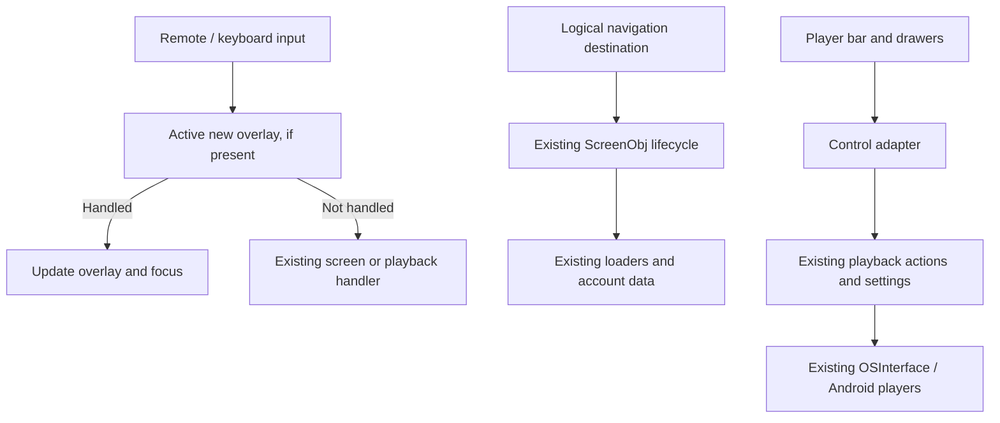

# Smarter Purple TV — UI/UX redesign implementation plan

Status: production source integration completed October 16, 2026 following user approval of purple/charcoal and the concrete prototype layout. The shell, real loaders, focus/refresh guards and player drawers are integrated and release assets regenerated as Web 751. Hardware acceptance, authenticated end-to-end coverage and publication remain pending. See [validation](ui-ux-redesign-validation.md), [feature inventory](ui-ux-feature-parity.md), [remote matrix](ui-ux-remote-matrix.md), and [prototype](../dev/ui-redesign/README.md). The phase completion criteria below still apply.

Source proposal: [UI/UX redesign proposal](ui-ux-redesign-proposal.md). Product requirements: [PRODUCT.md](../PRODUCT.md).

## 1. Outcome and boundaries

Deliver a coherent TV experience built around followed live channels, with one stable navigation menu and a compact player interface. Preserve all existing capabilities, account data, preferences, native player behavior, and remote shortcuts unless a specific behavior change is agreed during design review.

The completed redesign includes:

- Following as the normal browsing entry point, with Live now, Videos, Channels, and Categories tabs.
- Stable destinations for Following, Browse, Search, Library, Account, Settings, and Exit.
- Stream cards with consistent geometry, readable metadata, and a fixed focused-item detail area.
- A compact player bar, grouped drawers, and an accessible followed-channel switcher.
- Consistent focus, Back, loading, empty, authentication, and error behavior.
- Updated translations, help, theme support, generated assets, and release notes.

This work does not require a framework migration, a replacement Twitch data layer, or a rewrite of playback. Keep the existing global JavaScript architecture and old WebView compatibility. Introduce small, explicit presentation boundaries around existing behavior.

The user approved the purple/charcoal layout, three-column grid and compact player composition. DESIGN.md records the visual rules. Density, reading distance and native layering still require real-TV acceptance.

## 2. Findings that determine the implementation

| Finding in the current source | Implementation consequence |
| --- | --- |
| `Main.js` assigns numeric IDs to screens; `ScreenObj` in `Screens.js` supplies their lifecycle functions. | Keep existing IDs. Add logical navigation destinations that map to them, rather than renumbering or replacing the screen registry. |
| `Sidepannel.js` handles both menu modes and a followed-stream feed with native preview behavior. | Replace menu presentation separately from the followed-feed behavior. Removing the whole file would remove working playback paths. |
| `Screens_first_init()` handles Android intents, account selection, and playback restoration. | Add Following only to the ordinary startup path; preserve higher-priority intent and explicit startup preferences. |
| `Play_MakeControls()` describes actions and mode visibility, but callbacks also access control DOM, counters, and panel state. | Reuse actions through an audited adapter. Directly moving callbacks into a new drawer without handling these dependencies is unsafe. |
| `Play_handleKeyDown`, VOD/clip handlers, and `Play_KeyReturn()` contain mode-specific behavior. | New overlays consume input before legacy handlers; when no new overlay is active, delegate to the existing mode handler. |
| Screen, feed, and side-panel previews measure HTML bounds and send them to `OSInterface.js`. | Keep content geometry steady, test native overlay alignment, and cancel obsolete previews when focus or ownership changes. |
| `SettingsColor.js` supports several themes and custom colors. | New components must participate in the existing theme mechanism; hardcoded dark-only styling would remove a capability. |
| Development loads explicit script tags; `maker.js` gathers files by directory for the generated bundle. | Register new source scripts and test both load paths. Avoid cross-file initialization work at script evaluation time. |
| The working tree already contains unrelated application and generated changes. | Establish the exact starting revision and preserve existing changes. Review generated output against the integrated source baseline rather than blindly reverting unrelated output. |

Evidence is from source inspection. Device performance, live authentication flows, and the current rendered screens still need baseline verification in Phase 0.

## 3. Target implementation structure

### Keep existing systems authoritative

Use the existing screen loaders, authentication, playback actions, settings persistence, and bridge. New code should own navigation presentation, focus restoration, and overlay presentation—not duplicate the underlying state.



### Proposed new source files

These names are planned; none exists as a result of this document.

| File | Responsibility | Explicit boundary |
| --- | --- | --- |
| `app/specific/Navigation.js` | Logical destinations, tab-to-screen mapping, rail state, route context, and presentation hooks | Calls existing lifecycle functions; does not fetch stream data or replace numeric screen IDs |
| `app/specific/UIFocus.js` | Focus snapshots and input ownership for the new rail, tabs, details, bar, and drawers | Does not install a second competing global keyboard listener or rewrite legacy screen focus wholesale |
| `app/specific/PlayerUI.js` | Player bar/drawers, action grouping, adapter bindings, mode-aware rendering | Calls audited actions; does not implement streaming, quality requests, or chat transport |

Use project-style prefixed globals (`Navigation_*`, `UIFocus_*`, `PlayerUI_*`) and `var`/ordinary functions. Avoid imports, classes, optional chaining, arrow functions, and new unsupported platform dependencies in application source.

Keep redesign CSS in clearly labeled sections of `app/index.html` initially. The current build already minifies its inline CSS; extracting a new stylesheet would require a separate asset pipeline change without being necessary for the redesign. Scope selectors to the new surfaces and avoid broad changes to shared legacy classes.

Document approved visual roles and component rules in `DESIGN.md` when the implementation is validated. Resolve those roles through the existing theme system or legacy-compatible generated CSS, not required CSS custom properties.

### State ownership

- Existing `Main_values`, `ScreenObj`, `Play_controls`, and settings remain authoritative for their respective behavior.
- Navigation state stores logical destination/tab, origin, and a focus bookmark; it does not store another copy of stream records.
- A focus bookmark contains account identity, screen/content context, item identity, previous index, and scroll anchor. Resolve it against current data when restoring.
- Give each new asynchronous presentation operation a generation/account/context check. Late results must not update a different route, account, channel, or drawer.
- Persist only useful navigation preferences/bookmarks, with a versioned bounded structure. Keep transient overlay state, DOM references, timers, and request generations in memory.
- Do not write storage or invoke cloud backup on every arrow press. Save at route/visibility boundaries or through a bounded debounce consistent with the existing persistence flow.

## 4. Phase 0 — baseline and feature inventory

**Goal:** establish behavior that must survive before changing it.

Tasks:

1. Record the starting commit, dirty files, app/APK versions, available browser/device environments, and pre-existing test failures. Coordinate integration with ongoing phone-chat and native-request changes.
2. Run the current JSHint check and relevant existing fixtures once. Capture failures as baseline findings rather than folding unrelated repairs into the redesign.
3. Capture Following, both existing menu modes, player controls, Settings, and representative empty/error states in the source browser build and on a TV when available.
4. Create `docs/ui-ux-feature-parity.md`. Inventory every screen entry, settings entry, and player action—not only the high-level feature groups in the proposal.
5. For each inventory row record: current entry point, underlying function/control key, playback/account requirements, shortcuts, saved settings, proposed location, and verification status.
6. Create a remote behavior matrix covering Live, VOD, clips, full-screen chat, side-by-side chat, PiP, multistream, preview feed, end-of-stream, and modal dialogs. Include held keys, key-up handling, media keys, and number keys.
7. Measure baseline key-to-focus responsiveness, first useful home render, request counts, and preview behavior using the same content/device conditions planned for final checks. Record conditions and ranges, not a single unrepeatable number.

**Files to inspect:** `Main.js`, `Screens.js`, `ScreensObj.js`, `Sidepannel.js`, `Play*.js`, `UserLiveFeed*.js`, `Settings.js`, `SettingsColor.js`, `Users.js`, `AddUser.js`, `Search.js`, `ChannelContent.js`, and `PhoneChat.js`.

**Exit condition:** every existing feature family has an owner and destination, and the baseline distinguishes known defects from redesign regressions. Real-device checks that cannot yet run remain explicitly pending.

## 5. Phase 1 — visual specification and remote prototype

**Goal:** settle layout and interaction before changing shared screen/player code.

Tasks:

1. Produce representative compositions for Following, expanded navigation, the player bar, and one nested drawer. Compare how the same visual system behaves across all four.
2. Define type roles, minimum readable text sizes at the TV reference viewport, spacing, image ratios, safe margins, focus/selection/disabled states, theme roles, and motion timing. Check these against large-text and existing theme settings.
3. Resolve the relationship between rail, tabs, card grid, detail action, sort/filter controls, and footer hints. Specify every directional exit from each region.
4. Define card behavior for 0, 1, 2, 3, 4, 6, 7, and many items; pagination; missing images; long names/titles; and long translations.
5. Create an isolated local prototype/fixture under `dev/ui-redesign/`, outside production source discovery. Use clearly labeled synthetic content and basic arrows/Enter/Escape. Keep its fixture data and initialization out of the shipped bundle.
6. Simulate the actual flows: startup → stream → controls → Chat on phone → Back; switching channels; account changes; settings; and empty/error recovery.
7. Review at 1920×1080 and 1280×720, with the actual TV viewport scaling behavior and overscan-safe margins. Judge reading distance and focus on a TV, not just the browser.
8. Record the selected design and any deliberate shortcut changes. Do not interpret this planning request as approval of an unspecified palette or removal of a feature.

**Exit condition:** the visual direction and remote behavior are concrete enough to implement without inventing screen structure along the way. The prototype is a design aid; later integration tests must execute production code.

## 6. Phase 2 — navigation and focus foundations

**Depends on:** baseline inventory and the interaction specification.

### Logical destination mapping

Implement data-driven destination definitions in `Navigation.js`. Refer to named screen constants, never new numeric literals.

| Logical destination/tab | Existing target |
| --- | --- |
| Following / Live now | `Main_UserLive` |
| Following / Videos | `Main_UserVod` |
| Following / Channels | `Main_UserChannels` |
| Following / Categories | `Main_usergames` |
| Browse / Live, Featured, Categories, Videos, Clips | `Main_Live`, `Main_Featured`, `Main_games`, `Main_Vod`, `Main_Clip` |
| Search and its result types | `Main_Search`, `Main_SearchLive`, `Main_SearchChannels`, `Main_SearchGames`, `Main_SearchVod` |
| Library / Live, Videos, Clips | `Main_HistoryLive`, `Main_HistoryVod`, `Main_HistoryClip` |
| Account | Existing users/add-user/own-channel flows; `Main_Blocked` for blocked channels |
| Settings / help / updates / exit | Existing entry functions and dialogs |

Channel/category detail screens remain nested destinations. Carry their origin so Back returns to the correct tab and selected content. Treat search results similarly; a category opened from Search should return to Search rather than arbitrarily selecting Browse.

### Transition contract

1. Capture the outgoing focus bookmark and origin.
2. Close/suspend the outgoing presentation layer and cancel its pending preview work.
3. Use the existing exit/init lifecycle through a single navigation adapter. Do not call an exit twice or attach duplicate key listeners.
4. Render the destination labels/tabs and bind to its existing data/screen state.
5. Restore focus only when usable content exists; otherwise focus the appropriate recovery action.
6. Save a bounded bookmark at the transition boundary.

### Focus and overlay contract

Implement a small stack for new overlays only. Each entry identifies the owner, current focus, return target, close callback, and timer cleanup. Integrate legacy dialogs by explicitly suspending the new owner and restoring it after the dialog closes.

One input event has one owner. A handled event must not also toggle chat, seek, change multistream audio, or exit playback. Account for key-down/key-up pairs and long-press timers; closing an overlay must cancel its pending press operation.

Use deterministic grid neighbors, with no accidental wrapping across the first/last column. Restore by item identity, then nearest surviving neighbor, then the region's default. Derive numerical positions only after identity resolution.

### Startup precedence

Preserve the existing interactions between `start_user_screen`, `restor_playback`, and intents; characterize those combinations before editing `Screens_first_init()`. The intended policy is:

1. Honor a valid explicit Android intent/deep link.
2. Preserve explicit startup preferences, including account selection and supported playback restoration, with their current precedence.
3. Otherwise open Following / Live now for the active configured account.
4. With no configured account, show the Following onboarding state with Add account and Browse actions.

Do not equate an absent OAuth token with an absent account; preserve supported username-only/account fallback flows where the current app provides them.

**Validation:** production-code fixtures for route mapping, origin restoration, startup combinations, focus fallback, overlay ownership, and key-up cancellation.

**Exit condition:** the new presentation can reach every existing route without changing its data or playback behavior.

## 7. Phase 3 — stable navigation shell

**Depends on:** Phase 2 and approved visual specification.

Tasks:

1. Add the rail, labeled expanded state, tabs, and utility area to `app/index.html`. Keep content dimensions stable while the rail expands.
2. Connect menu entries to the logical mapping. Focus movement updates focus only; OK activates a destination.
3. Separate the old menu-mode code in `Sidepannel.js` from its followed-feed code. Keep callbacks used by native previews and playback intact.
4. Replace `Sidepannel_SetUserLabels`/`Sidepannel_SetDefaultLabels` behavior for migrated browsing surfaces with stable navigation labels. Audit callers of `Sidepannel_SetTopOpacity` and `Main_values.Sidepannel_IsUser` rather than deleting them indiscriminately.
5. Make active destination and remote focus visually distinct. Provide useful accessible labels for icon controls and preserve mouse/keyboard development support.
6. Wire Left from the first content column into the rail, Right back to content, and explicit transitions between tabs, content, and details. Empty screens must still allow navigation.
7. Ensure Update, About, Controls help, and Exit remain reachable from the utility area while their eventual Settings grouping is completed.
8. Keep old views reachable in development through an implementation-only switch until migration validation completes. Do not create a permanent user-facing “old/new UI” setting by default.

**Validation:** visit all destinations; switch tabs repeatedly; enter/leave nested Search and channel screens; open dialogs from the rail; switch accounts; test no-account operation. Check event-listener/timer cleanup and source/bundle loading.

**Exit condition:** the old main/user menu distinction is gone from normal browsing and every previous destination remains reachable.

## 8. Phase 4 — Following home and stable content refresh

**Depends on:** Phase 3.

### Rendering

1. Reuse `ScreensObj_InitUserLive` and existing data retrieval. Add a presentation option to the shared screen renderer for the new live-card layout rather than globally changing every VOD/category/channel card.
2. Keep item IDs used by existing actions and preview measurements stable, or update every dependent lookup in the same change. Inventory `Screens_ScreenIds` consumers first.
3. Render thumbnail, LIVE state, channel name, category, and viewer count with fixed geometry. Move the focused title into the fixed detail area; show an explicit channel-details action there.
4. Keep sorting/filtering and manual refresh accessible. Preserve existing preferences and backend order when no explicit sort is selected.
5. Make card activation call the current stream-opening path. Do not require an extra details screen before playback.

### Refresh and account safety

Maintain a display order keyed by stable channel/content identity. During an active browsing session, update metadata in place, preserve surviving order, and queue reorder requests until a defined boundary: explicit refresh, sort change, or re-entry. New items can be appended consistently until that boundary.

If the focused channel ends, resolve focus once to the nearest surviving item, update the detail area, and explain the status if activation was in progress. OK must resolve the currently displayed identity against current data, never use an obsolete array index.

Bind async results to account, route/query, and generation. After account switch, invalidate requests/bookmarks for the old account and clear its content immediately. Apply the same checks to delayed thumbnail/preview results.

Use the existing feed/data owners initially. Do not add a second polling loop to make home and the player switcher look consistent. If the current owners produce different orderings, normalize presentation ordering without merging their transports as part of this redesign.

### State handling

Provide loading, no account, authorization needed, no followed channels, nobody live, stale content, retry, and missing-image states. Only distinguish “no follows” from “nobody live” when existing data proves the distinction; an empty live-stream result alone does not prove the user follows nobody. Use neutral copy if evidence is unavailable.

Keep last successful content on transient refresh failures, mark it stale, and retain Retry. Do not show data from a previous account as a stale fallback.

### Preview lifecycle

Preserve the configured preview delay and volume. Cancel pending preview work when focus changes, a drawer/rail covers it, the screen exits, or the account changes. Start only the latest eligible preview.

Check `Screens_LoadPreviewRestore`, `Sidepannel_SetPlayerViewSidePanel`, and feed geometry calls against the new layout. A WebView rail can otherwise be obscured by a native video surface; explicitly suspend/hide the preview while the rail overlaps its bounds and restore it afterward.

**Validation:** empty/small/large paginated fixtures; out-of-order responses; stream ending during focus; reorder during key repeat; account change during load; retry after failure; long text; missing art; preview cancellation and restoration.

**Exit condition:** Following supports the complete browse → watch → return flow with stable identity and geometry, including failure states.

## 9. Phase 5 — migrate remaining browsing surfaces

**Depends on:** the validated shell and Following implementation.

Tasks:

1. Apply the shell/tab structure to Browse while preserving category, featured, VOD, and clip-specific filters and sorting.
2. Keep category artwork and channel/avatar cards appropriate to their content; share focus, typography, spacing, and loading behavior instead of forcing every item into a live-stream card.
3. Consolidate Search entry and result tabs without changing its existing input, query, or result semantics. Preserve search origin and nested search Back behavior.
4. Add Library tabs over current history screens. Show resume actions only where a saved playable position exists. Preserve deletion and confirmation flows.
5. Group account switching, add/remove account, own channel, and blocked channels under Account. Recompute tab availability and clear account-scoped state after switch/remove/revoke.
6. Restyle channel/category details to fit the new shell while preserving follow/unfollow, videos, clips, and playback entry points.
7. Complete the browsing portion of the parity checklist. Search for old menu assumptions in help strings, page-up/page-down navigation, notifications, and Android intent mappings.

**Validation:** route round trips, content filters, account removal, history deletion, saved resume positions, blocked-channel behavior, and Android entry routes.

**Exit condition:** every browsing screen fits the new navigation model and has a tested return path.

## 10. Phase 6 — audit and adapt player actions

**Can begin after:** Phase 0 inventory. Integrate after the focus contract is stable.

This is the most sensitive code phase. `Play_controls` mixes behavior with presentation: callbacks refer to fields such as `doc_title`, `doc_name`, `defaultValue`, and current panel position, and some actions switch control-visibility groups.

Tasks:

1. Enumerate each `Play_controls*` constant and the control created in `Play_MakeControls()`. Record `ShowInLive`, `ShowInVod`, `ShowInClip`, `ShowInPP`, `ShowInMulti`, and specialized chat/audio/preview groups.
2. For each action, classify it as direct command, toggle, value selector, navigation action, nested panel, or mode transition. Record its DOM and panel-state dependencies.
3. Define a named descriptor in `PlayerUI.js` for each migrated action: identity, group, translated label, current value, availability/reason, execute/adjust callback, and close/keep-open behavior.
4. Use existing named constants to resolve controls. Do not duplicate incremented numeric control indexes in new code.
5. Extract behavior from presentation only where necessary. Existing and new UI callers should invoke the same behavior function; presentation refresh belongs to the active renderer.
6. For callbacks that require the old control DOM, either bind the required document references to the new renderer or finish the narrow extraction before enabling the new action. Do not rely indefinitely on invisible duplicate controls as a hidden dependency.
7. Preserve validation inside the action: codec limits, quality availability, chat state, subscription/auth restrictions, and multistream capacity must still be checked at execution time.
8. Recompute labels and availability after channel/mode/quality/chat changes. If the focused action disappears, move focus to a valid neighbor. If the new mode invalidates the whole drawer, close it and restore an appropriate parent.

**Validation:** execute production actions through the adapter using bridge/data stubs; assert actual side effects and argument targets. Include actions whose values or availability change while their drawer is open.

**Exit condition:** every action intended for the new bar/drawers can execute correctly without the old strip owning input or state.

## 11. Phase 7 — compact player bar, drawers, and channel switcher

**Depends on:** Phases 2 and 6; integrate alongside the completed browsing experience.

### Bar and drawers

1. Add Play/Pause, Chat, Quality, Layout, and More with translated visible labels and real current state. Derive availability per playback mode.
2. Keep VOD/clip timeline, seeking, chapters, and progress on their appropriate surfaces. Preserve existing seek increments and held-key behavior.
3. Implement vertical drawers using the new overlay owner. Back returns to the exact originating button/row. Nested drawers preserve their parent position.
4. Put Chat on phone near the top of Chat. Reuse `PhoneChat.js` and its existing QR/dialog lifecycle; return focus to Chat when it closes and preserve number-key entry.
5. Group More into Channel/content, Playback, Audio, Preview, and Diagnostics. Use explicit Channels as a discoverable alternative to Up.
6. Preserve existing automatic bar-hide timing where practical. Suspend it while a drawer or legacy modal is active; closing a drawer resumes a fresh delay. Backgrounding/exit cancels all new timers.
7. Integrate the new input owner before the existing Live/VOD/clip handlers. When it consumes a key, neither the old strip nor underlying video should receive that key.
8. Keep `Play_KeyReturn` and mode-exit preferences authoritative once all new overlays are closed. Back must not silently change single-click exit, PiP closure, multistream exit, or playback restoration policies.

### Switcher and layouts

1. Reuse `UserLiveFeed` and its open/preview paths for the followed-channel row. The home and switcher should use consistent labels, card focus, and sort semantics, without an extra data-fetch loop.
2. Up opens the switcher with the current channel selected where present. Left/Right moves; OK selects; Back returns to unchanged playback.
3. Retain existing feed sections such as categories and other content through explicit switcher tabs or a named Browse action. Narrowing the default to followed channels must not remove the other feed capabilities.
4. In PiP/multistream, show the destination slot and reuse existing add/replace logic. Clearly identify the audible stream. Preserve per-stream quality, resync, mute, and volume controls.
5. Verify layer composition with real native video surfaces: drawers, QR codes, chat, previews, and multistream windows must not cover each other incorrectly.

**Validation:** all playback modes; unsupported device capability; stream ending during drawer use; network failure; channel switch while phone chat is connected; rapid open/close; held-key cancellation; media/number keys; simultaneous chat and preview.

**Exit condition:** the old control strip is no longer needed for user interaction, all player actions have verified destinations, and no new overlay leaks keys or timers.

## 12. Phase 8 — settings, themes, translations, and migration

**Depends on:** stable navigation and player groups; theme/string work also accompanies earlier phases.

Tasks:

1. Reorganize existing Settings entries by purpose without renaming their persisted keys. Preserve defaults, ranges, descriptions, custom colors, fonts, notifications, codec/buffer controls, ad blocking, backup/sync, and update settings.
2. Integrate new component colors and focus into `SettingsColor.js` and its generated styles. Check dark, light, and custom themes; do not assume secondary text can always be gray on black.
3. Add new labels to `en_US.js` and declarations to `0_Strings.js`. Inspect the actual language initialization/fallback path before relying on English fallback.
4. The local README delegates translation instructions upstream. Retrieve/read those instructions before editing language files, follow the `untranslated_*.txt` convention, and avoid claiming translations that have not been supplied.
5. Update remote help and contextual hints to describe the new visible routes. Preserve specialized shortcut documentation and distinguish mode-dependent actions.
6. Add versioned UI bookmark/preferences migration only if needed. Preserve existing startup choices; validate account/screen/item references and discard invalid bookmarks safely.
7. Test older settings payloads, missing/corrupt UI state, removed accounts, and backup restore. Do not migrate ephemeral state into cloud backup accidentally.
8. Remove obsolete menu state and CSS only after references, parity checks, and both builds confirm it is unused. Keep a small compatibility reader for old persisted values where necessary.

**Exit condition:** existing users retain their settings and capabilities; every new user-visible string has a valid rendering path; themes and help match the redesigned experience.

## 13. Phase 9 — integration validation and release readiness

**Depends on:** completed browsing/player integration and settings migration. Targeted checks below also run during the earlier phases; this phase closes the combined acceptance matrix.

**Exit condition:** feature parity, source/bundle checks, and device verification are complete, with any remaining limitations recorded before the release steps in Section 14.

### New targeted harnesses

Create these alongside the relevant behavior changes, using the repository's Node/VM fixture style. Names below are proposed commands, not currently available tests.

| Proposed harness | Required coverage |
| --- | --- |
| `release/scripts/navigation-tests.js` | Destination mapping, route origin, startup precedence, account scoping, Back, and source/bundle initialization |
| `release/scripts/ui-focus-tests.js` | Directional edges, overlay ownership, restoration by identity, invalidated targets, key repeat/key-up cleanup |
| `release/scripts/following-tests.js` | Stable refresh order, pagination, stale callbacks, empty/auth/error distinctions, current-identity activation, preview cancellation |
| `release/scripts/player-ui-tests.js` | Production action adapter, mode visibility, live values, nested drawers, timer suspension, phone-chat return, PiP/multistream target selection |

Tests must load the production functions; do not copy a simplified implementation into the harness. Use a fake clock for dwell/hide/race tests and bridge stubs that record calls. DOM/style assertions alone do not demonstrate working playback. Add generated-bundle coverage only through a deliberate test entry point that does not expose test-only APIs to production.

### Existing commands

Run from the repository root, at the stages described below:

```bash
node release/scripts/maker.js jsh
node release/scripts/phonechat-tests.js
node release/scripts/update-tests.js
node release/scripts/phonechat-collector-tests.js
node release/scripts/chat-optimization-tests.js
node release/scripts/maker.js
node release/scripts/phonechat-tests.js --built
```

Use JSHint and relevant new harnesses for each behavioral change. Run the existing phone-chat/collector/chat fixtures when integrating player/chat changes, update tests for startup/release changes, and the combined affected suite at final integration. Run the full build at integration milestones and before delivery; verify the generated app as well as source mode.

If native bridge/player code changes, also run the applicable Java fixtures and APK checks:

```bash
node release/scripts/request-dispatcher-tests.js
node release/scripts/phonechat-server-tests.js
```

The dispatcher harness requires JDK 8+ with the documented compiler support; the phone-chat server harness requires JDK 17+ and Android SDK 35. Report unavailable prerequisites as unverified coverage, not a passing result.

### Browser and real-device matrix

| Dimension | Minimum cases |
| --- | --- |
| Build | Source `app/index.html`; generated `release/index.html` |
| Display | 1080p and 720p; enlarged text; overscan-safe boundaries; long translations |
| Theme | Default, light, custom colors; animation enabled/disabled |
| Input | Basic D-pad/OK/Back, held arrows, keyboard, media keys, supported number-key shortcuts |
| Account | None, valid, authorization needed, switch/remove during request, supported alternate account flow |
| Content | Empty, one item, partial rows, multiple pages, missing art, long text, stream ending |
| Network | Initial failure, refresh failure, delayed/out-of-order response, retry, disconnect/reconnect |
| Playback | Live, VOD, clip, chat modes, PiP, multistream, end dialogs, external-player handoff |
| Lifecycle | Fresh launch, deep link, playback restore, background/resume, update/reload, backup restore |

Use Chrome for browser keyboard checks and an older supported TV WebView/device for compatibility. A desktop browser cannot certify native player positioning, codec limits, video-surface layering, Android Back, or phone-chat server behavior.

For device source testing, use the documented `up_assets.sh` workflow, then restore/clean its temporary asset/`LoadFromAssets` changes. APK builds require the sibling custom Media3 checkout and documented handling of private Google services configuration. Do not commit development-only native configuration edits.

### Performance acceptance

- Focus feedback must not wait for thumbnail downloads, metadata requests, or native preview startup.
- Compare repeated key presses and startup under the same baseline conditions. Investigate a material regression before shipping; establish numeric budgets from the Phase 0 measurements.
- One eligible preview operation at a time, respecting device codec capacity and the existing main-player/preview rules.
- No increasing count of listeners, timers, retained DOM nodes, or cached route data after repeated open/close and route/account switches.
- Avoid full-grid rerender on every focus move and repeated layout measurements within a single input event. Read geometry after layout settles, then apply bridge updates.

Store results and remaining limitations in `docs/ui-ux-redesign-validation.md` with build/device identifiers and screenshots. Prototype screenshots are design evidence, not implementation test evidence.

## 14. Integration sequence and release strategy

Use small, reviewable commits or PRs, each keeping the app runnable:

| Change set | Contents | Completion gate |
| --- | --- | --- |
| 1 | Baseline, parity inventory, remote matrix, approved design/prototype | Scope and behavior recorded |
| 2 | Navigation mapping, input ownership, focus bookmarks, targeted fixtures | Legacy routes still work |
| 3 | Rail/tabs/utilities and startup integration | All destinations reachable; preferences/intents preserved |
| 4 | Following cards, details, refresh/error states, native preview alignment | Browse → watch → return passes |
| 5 | Browse/Search/Library/Account/detail integration | Browsing parity complete |
| 6 | Player action adapter and necessary narrow extractions | Existing actions pass through adapter |
| 7 | Player bar/drawers/phone-chat integration | Overlay and playback-mode checks pass |
| 8 | Switcher and PiP/multistream integration | Complete player parity and device checks |
| 9 | Settings, localization, theme and help completion; remove obsolete UI | Preference migration and all themes pass |
| 10 | Final validation, version/changelog, regenerated assets | Release checklist complete |

Foundations are not a user release. First complete milestone: shell plus Following and working access to every existing destination. Second: consistent browsing across all destinations. Third: complete player redesign and settings/help integration. Release these as separate web updates only if each is coherent and independently verified; otherwise ship one integrated redesign.

Use a local/development switch during integration to compare legacy and new presentations. Remove that switch and unreachable implementation code after parity is confirmed. Do not keep two complete production UIs as an indefinite maintenance burden.

For each actual web release:

1. Re-read the current `WebTag`; increment it by one, set `WebVersion` to the actual release date, and add a user-facing changelog entry in `app/general/version.js`. Do not hardcode the version observed during planning.
2. Run the full build. Review and commit regenerated `release/` outputs and `apk/Changelog_Up.md` as produced, including version metadata.
3. Verify startup and update checks against the generated build. Ensure no prototype assets or development bypasses are included.
4. Preserve the previous known-good source/bundle reference. If rollback is needed, rebuild the corrected/reverted UI with a higher web version so devices can receive it; do not rely on decreasing the version number.
5. Treat deployment/publication as a separate release action. This plan does not deploy anything.

Prefer a web-only release. If a new native bridge capability proves necessary, revise the scope: implement both `OSInterface.js` and the Java interface, retain an older-APK fallback/capability check, expose any required APK-to-web callbacks through `release/api.js`, and follow the APK version/changelog/build workflow. Do not ship calls that older installed APKs cannot handle.

## 15. Risks and explicit decisions

| Risk / decision | Resolution |
| --- | --- |
| Visual specification | Purple/charcoal and concrete prototype layout approved; production integration follows DESIGN.md |
| Fewer controls makes features undiscoverable | Named drawers, visible labels, explicit Channels/phone-chat entries, and complete parity checklist |
| Player callbacks depend on old DOM | Audit and adapt/extract before removing the strip; test actual actions |
| Rail/drawer overlaps native previews | Stable geometry plus preview suspend/restore and real-TV layer checks |
| Focus jumps after refresh | Stable identities, bounded refresh reconciliation, generation guards, deterministic fallback |
| New keyboard handling fires legacy actions too | One owner, handled-event boundary, key-up and long-press cleanup |
| Following default overrides user behavior | Preserve intent/startup-preference precedence and introduce Following only as normal browsing default |
| Shared CSS changes unrelated screens | Scoped new selectors and incremental renderer adoption |
| New file loads differently in source and release | Explicit source script registration, runtime initialization after dependencies, generated-build smoke test |
| Existing color/customization features break | Extend theme integration and verify light/custom themes, text sizes, and disabled animation |
| Shared working tree changes during implementation | Re-read touched code before editing, keep scope-focused diffs, reconcile the final build against all integrated source |

The visual specification is approved. Engineering validation must settle reading distance, input behavior and exact preview/layer behavior on target devices. Desktop checks do not certify those conditions.

## 16. Definition of done

- [ ] Normal configured startup lands on followed live channels without breaking explicit startup choices or intents.
- [ ] Every previous screen, setting, action, and supported shortcut has a verified destination in the parity inventory.
- [x] Home, browsing, player, and Settings use a coherent approved visual language.
- [ ] Remote focus is visible, predictable, restorable, and stable across refresh and account changes.
- [x] Basic-remote users can find quality, phone chat, channel switching, and supported multi-view controls.
- [ ] Old settings/accounts/history remain valid, including backup/restore and supported themes.
- [x] Source and generated builds pass the applicable fixtures and browser checks.
- [ ] Real-device checks verify native overlays, playback modes, old WebView compatibility, and input responsiveness.
- [x] Translation/help coverage is complete or explicitly tracked through the project's untranslated-string workflow with working fallback.
- [ ] No temporary fixture, asset-loading flag, compatibility bypass, or obsolete parallel UI ships accidentally.
- [x] `DESIGN.md`, the feature inventory, and validation results describe the final implementation.
- [x] Release version/changelog and generated artifacts are consistent; unresolved limitations are stated explicitly.

Production integration is complete in the working tree. Unchecked acceptance items above require authenticated and/or real-TV execution; the validation document separates shipped code, fixture coverage, browser observations and pending hardware checks. Deployment remains a separate release action.
